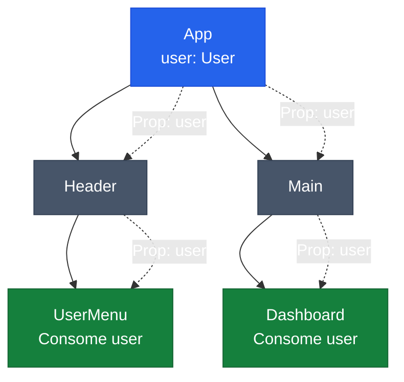
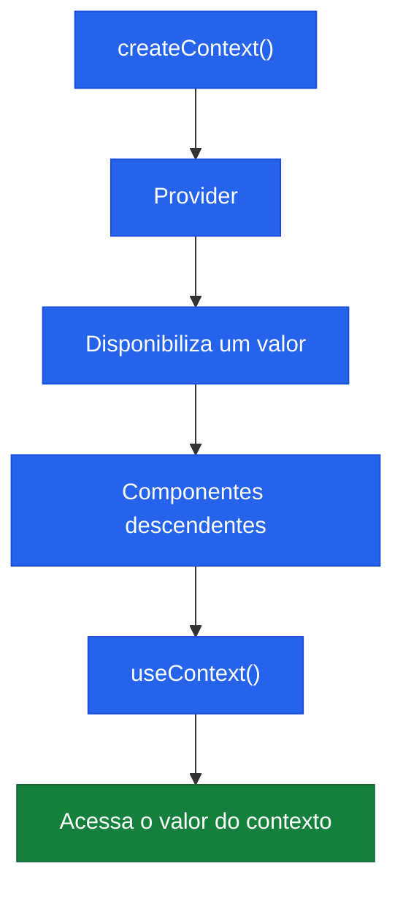
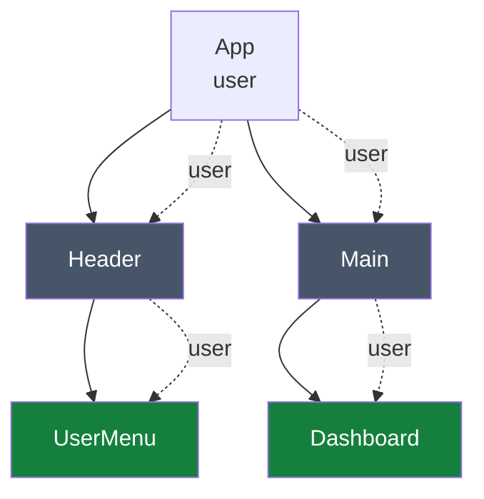
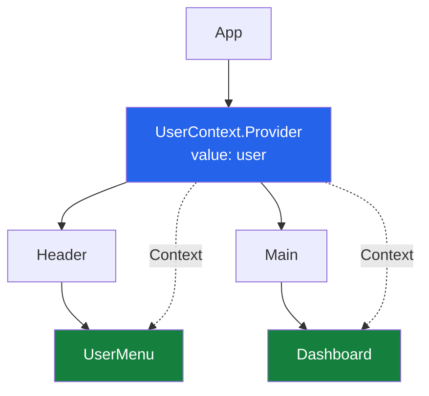

# React Context API

## Compartilhamento de estado e dados entre componentes

**Apresentação técnica | React + TypeScript**

**Duração estimada:** 25–30 minutos

**Público:** Desenvolvedores Frontend

# 1. Introdução

### Compartilhamento de dados entre componentes

Em aplicações React, é comum que diferentes componentes precisem acessar as mesmas informações.

**Exemplos:**

- Informações do usuário autenticado.
- Preferências de tema (Light / Dark).
- Idioma selecionado.
- Informações de um carrinho de compras.

<div class="mt-6 p-4 rounded bg-blue-500/10 border-l-4 border-blue-500">
  <strong>Pergunta:</strong> como compartilhar essas informações sem precisar transmiti-las manualmente por toda a árvore de componentes?
</div>

---

# 2. O problema: Prop Drilling

<div class="grid grid-cols-2 gap-6 mt-2 items-start">
<div>

### O que é Prop Drilling?

É o processo de transmitir propriedades (*props*) através de múltiplos níveis de componentes até alcançar aquele que realmente precisa utilizá-las.

<div class="mt-6 p-4 rounded bg-amber-500/10 border-l-4 border-amber-500 text-sm">
  <strong>Problema:</strong> <code>Header</code> e <code>Navigation</code> precisam retransmitir uma propriedade que não utilizam diretamente.
</div>

</div>
<div>

```tsx {*|1-4|3,6-8|3,6-8,10-12|14-16}
function App() {
  const user = { name: "Luiz" };
  return <Header user={user} />;
}

function Header({ user }) {
  return <Navigation user={user} />;
}

function Navigation({ user }) {
  return <UserMenu user={user} />;
}

function UserMenu({ user }) {
  return <span>{user.name}</span>;
}
```

</div>
</div>

---

# 3. Visualizando o problema

### Transmissão de propriedades através da árvore de componentes

<div class="grid grid-cols-2 gap-6 mt-2 items-center">
<div>



</div>
<div>

### Consequências

- Aumento do acoplamento entre componentes.
- Maior complexidade na manutenção.
- Transmissão desnecessária de propriedades.
- Dificuldade de refatoração da árvore de componentes.

</div>
</div>

---

# 4. O que é React Context API?

O **React Context API** é um mecanismo nativo do React que permite compartilhar informações entre componentes sem precisar transmitir essas informações explicitamente através de props.

### Conceitos fundamentais

- Permite disponibilizar dados para componentes descendentes.
- Elimina a necessidade de retransmitir propriedades por componentes intermediários.
- Pode compartilhar valores, estados e funções.
- Funciona em conjunto com outros recursos do React, como `useState` e `useReducer`.

<div class="mt-4 p-3 rounded bg-blue-500/10 border-l-4 border-blue-500 text-sm">
  <strong>Importante:</strong> Context API é um mecanismo de compartilhamento de dados, não uma solução completa de gerenciamento de estado por si só.
</div>

---

# 5. Como funciona o Context API?

O funcionamento pode ser dividido em três etapas:

<div class="grid grid-cols-2 gap-6 mt-2 items-center">
<div class="space-y-3 text-sm">

### 1. Create Context
Criamos um objeto de contexto utilizando `createContext`.

### 2. Provider
Disponibilizamos um valor para os componentes descendentes.

### 3. Consume Context
Os componentes interessados acessam o valor através de `useContext`.

</div>
<div class="flex justify-center">



</div>
</div>

---

# 6. Etapa 1: Criando um Context

Utilizamos a função `createContext`, disponibilizada pelo React.

<div class="grid grid-cols-2 gap-6 mt-2 items-start">
<div>

```tsx {*|10-12,15|16}
// contexts/UserContext.ts
import { createContext } from "react";

interface User {
  id: number;
  name: string;
  email: string;
}

interface UserContextData {
  user: User | null;
}

export const UserContext =
  createContext<UserContextData>({
    user: null,
  });
```

</div>
<div class="text-sm">

### Pontos importantes

- `createContext` retorna um objeto de contexto.
- O argumento representa o valor padrão (*default value*).
- O contexto não armazena o estado da aplicação por conta própria.
- O valor padrão é utilizado quando não existe um Provider correspondente acima do consumidor.

</div>
</div>

---

# 7. Etapa 2: Disponibilizando o Context

Utilizamos o Provider para disponibilizar os dados aos componentes descendentes.

<div class="grid grid-cols-2 gap-6 mt-2 items-start">
<div>

```tsx
// App.tsx
import { useState } from "react";
import { UserContext } from "./contexts/UserContext";

function App() {
  const [user] = useState({
    id: 1,
    name: "Luiz",
    email: "luiz@email.com",
  });

  return (
    <UserContext.Provider value={{ user }}>
      <Header />
      <Dashboard />
    </UserContext.Provider>
  );
}
```

</div>
<div class="text-sm">

### O que está acontecendo?

- `UserContext.Provider` disponibiliza o valor do contexto.
- A propriedade `value` define quais informações serão compartilhadas.
- Todos os componentes descendentes podem acessar esse valor.

<div class="mt-4 p-3 rounded bg-blue-500/10 border-l-4 border-blue-500 text-xs">
  <strong>Nota:</strong> a sintaxe <code>.Provider</code> é a forma tradicional, compatível com versões anteriores e com React 19. No React 19 também podemos utilizar diretamente <code>&lt;UserContext value={...}&gt;</code>.
</div>

</div>
</div>

---

# 8. Etapa 3: Consumindo o Context

Para acessar os dados, utilizamos o Hook `useContext`.

<div class="grid grid-cols-2 gap-6 mt-4 items-start">
<div>

```tsx
// components/UserMenu.tsx
import { useContext } from "react";
import { UserContext } from "../contexts/UserContext";

function UserMenu() {
  const { user } = useContext(UserContext);

  return (
    <div>
      <span>Olá, {user?.name}</span>
    </div>
  );
}
```

</div>
<div>

### O que acontece?

- `useContext` recebe o objeto de contexto.
- O React procura o Provider correspondente mais próximo na árvore.
- O componente recebe o valor disponibilizado por esse Provider.

</div>
</div>

---

# 9. Comparação: antes e depois do Context API

<div class="grid grid-cols-2 gap-6 mt-2 items-start">
<div class="flex flex-col items-center">

### Antes: Prop Drilling



</div>
<div class="flex flex-col items-center">

### Depois: Context API



</div>
</div>

<div class="mt-2 p-2 rounded bg-green-500/10 border-l-4 border-green-500 text-sm text-center">
  <strong>Resultado:</strong> os componentes intermediários deixam de precisar retransmitir as informações.
</div>

---

# 10. Compartilhando estados e funções

O Context API não se limita a disponibilizar informações estáticas. Podemos compartilhar estados e suas respectivas funções de atualização.

<div class="grid grid-cols-2 gap-6 mt-4 items-center">
<div>

### Exemplo: Theme Context

```tsx
type Theme = "light" | "dark";

interface ThemeContextData {
  theme: Theme;
  toggleTheme: () => void;
}
```

</div>
<div class="space-y-3">

- Disponibilizamos tanto o **tema atual** quanto a **função** responsável por modificá-lo.
- Isso permite que qualquer componente descendente consulte e altere o tema da aplicação.

</div>
</div>

---

# 11. Implementação prática: Theme Provider

<div class="grid grid-cols-12 gap-6 mt-1 items-start">
<div class="col-span-7">

```tsx
import { createContext, useState } from "react";

type Theme = "light" | "dark";
interface ThemeContextData {
  theme: Theme;
  toggleTheme: () => void;
}

export const ThemeContext =
  createContext<ThemeContextData | null>(null);

export function ThemeProvider({ children }: { children: React.ReactNode }) {
  const [theme, setTheme] = useState<Theme>("light");

  function toggleTheme() {
    setTheme((curr) => (curr === "light" ? "dark" : "light"));
  }

  return (
    <ThemeContext.Provider value={{ theme, toggleTheme }}>
      {children}
    </ThemeContext.Provider>
  );
}
```

</div>
<div class="col-span-5 text-sm">

### O que aprendemos?

- O `useState` mantém o estado.
- O Provider disponibiliza o estado e a função de atualização.
- Os componentes consumidores podem interagir com esse estado compartilhado.

</div>
</div>

---

# 12. Custom Hooks e Context API

Uma boa prática é encapsular o consumo do contexto em um Custom Hook.

<div class="grid grid-cols-2 gap-6 mt-2 items-start">
<div>

```tsx
// hooks/useTheme.ts
import { useContext } from "react";
import { ThemeContext } from "./ThemeContext";

export function useTheme() {
  const context = useContext(ThemeContext);

  if (!context) {
    throw new Error(
      "useTheme deve ser usado dentro de ThemeProvider"
    );
  }

  return context;
}
```

</div>
<div class="text-sm">

```tsx
// Consumo no componente
function ThemeButton() {
  const { theme, toggleTheme } = useTheme();

  return (
    <button onClick={toggleTheme}>
      Tema atual: {theme}
    </button>
  );
}
```

### Vantagens

- Centralização da lógica de consumo e melhor legibilidade.
- Identificação imediata de componentes fora do Provider.
- Maior facilidade de manutenção.

</div>
</div>

---

# 13. Vantagens do Context API

<div class="space-y-3 mt-6">

- **Redução do Prop Drilling:** evita retransmitir propriedades desnecessariamente.
- **Menor acoplamento:** componentes intermediários não precisam conhecer dados que não utilizam.
- **API nativa:** não exige bibliotecas externas.
- **Simplicidade:** implementação direta para estados compartilhados.
- **Organização:** permite separar informações por responsabilidade.

</div>

---

# 14. Desvantagens e limitações

<div class="text-sm space-y-1 mt-2">

- **Re-renderizações:** mudanças no valor do contexto atualizam seus consumidores.
- **Performance:** contextos muito abrangentes podem provocar atualizações desnecessárias.
- **Escalabilidade:** muitos Providers podem dificultar a organização da aplicação.
- **Seleção de estado:** não oferece nativamente seletores por propriedade.
- **Server State:** não possui mecanismos próprios de cache e sincronização de requisições.

</div>

<div class="mt-4 p-4 rounded bg-amber-500/10 border-l-4 border-amber-500 text-sm">
  <h4 class="font-bold mb-1">Atenção!</h4>
  <p>O uso de Context API não significa automaticamente problemas de performance. O importante é compreender como as atualizações acontecem e organizar os contextos adequadamente.</p>
</div>

---

# 15. Boas práticas

<div class="grid grid-cols-2 gap-x-6 gap-y-3 mt-3 text-sm">
<div class="p-3 rounded bg-gray-500/10">

### 1. Separe por responsabilidade
Evite concentrar todas as informações da aplicação em um único contexto.

</div>
<div class="p-3 rounded bg-gray-500/10">

### 2. Evite estados globais desnecessários
Nem todo estado precisa estar em um Context.

</div>
<div class="p-3 rounded bg-gray-500/10">

### 3. Utilize Custom Hooks
Centralize e valide o acesso aos contextos.

</div>
<div class="p-3 rounded bg-gray-500/10">

### 4. Considere memoização
Utilize `useMemo` e `useCallback` quando necessário para evitar mudanças de referência.

</div>
<div class="col-span-2 p-3 rounded bg-gray-500/10">

### 5. Evite Providers excessivamente abrangentes
Defina o escopo do Provider de acordo com os componentes que realmente precisam consumir suas informações.

</div>
</div>

---

# 16. Performance: como afeta as renderizações?

Quando o valor de um contexto muda, os componentes que consomem aquele contexto são atualizados.

<div class="grid grid-cols-2 gap-6 mt-2 items-start">
<div>

```tsx
const CounterContext = createContext(0);

function CounterProvider({ children }) {
  const [count, setCount] = useState(0);

  return (
    <CounterContext.Provider value={count}>
      {children}
    </CounterContext.Provider>
  );
}

function CounterDisplay() {
  const count = useContext(CounterContext);
  console.log("CounterDisplay renderizou");
  return <span>{count}</span>;
}
```

</div>
<div class="text-sm">

### O que acontece?

- O estado `count` é atualizado.
- O valor do Provider muda.
- Os consumidores daquele contexto são atualizados.

<div class="mt-4 p-3 rounded bg-blue-500/10 border-l-4 border-blue-500">
  <strong>Detalhe técnico:</strong> o React utiliza <code>Object.is</code> para comparar o valor anterior com o novo valor do contexto.
</div>

</div>
</div>

---

# 17. Context API e React.memo

Uma dúvida comum é: podemos utilizar `React.memo` para impedir essas renderizações?

<div class="grid grid-cols-2 gap-6 mt-3 items-start">
<div>

```tsx
import { memo, useContext } from "react";

const CounterDisplay = memo(() => {
  const count = useContext(CounterContext);

  console.log("CounterDisplay renderizou");

  return <span>{count}</span>;
});
```

<p class="text-xs mt-3 opacity-80">
  Mesmo utilizando <code>React.memo</code>, o componente continuará sendo atualizado quando o contexto consumido mudar.
</p>

</div>
<div class="text-sm">

### Por quê?

`React.memo` compara as **propriedades (props)** recebidas pelo componente, mas não bloqueia atualizações provenientes de seus próprios contextos.

<div class="mt-4 p-3 rounded bg-amber-500/10 border-l-4 border-amber-500">
  <strong>Conclusão:</strong> <code>React.memo</code> não é uma solução para impedir atualizações provocadas pelo Context API.
</div>

</div>
</div>

---

# 18. Context API + useReducer

O `useReducer` é uma alternativa ao `useState` quando precisamos organizar atualizações de estado por meio de ações centralizadas em um *reducer*.

<div class="grid grid-cols-12 gap-6 mt-2 items-start">
<div class="col-span-7">

```tsx
type CounterState = { count: number };

type CounterAction =
  | { type: "INCREMENT" }
  | { type: "DECREMENT" }
  | { type: "RESET" };

function counterReducer(
  state: CounterState,
  action: CounterAction
): CounterState {
  switch (action.type) {
    case "INCREMENT":
      return { count: state.count + 1 };
    case "DECREMENT":
      return { count: state.count - 1 };
    case "RESET":
      return { count: 0 };
    default:
      return state;
  }
}
```

</div>
<div class="col-span-5 text-sm">

### Benefícios

- Centralização das regras de atualização.
- Transições de estado previsíveis.
- Organização clara de ações.
- Melhor estruturação de estados mais complexos.

</div>
</div>

---

# 19. Separação de State e Dispatch Context

Uma abordagem interessante é separar o contexto responsável pelo estado daquele responsável pelas ações.

<div class="grid grid-cols-12 gap-6 mt-2 items-start">
<div class="col-span-7">

```tsx
const CounterStateContext =
  createContext<CounterState | null>(null);

const CounterDispatchContext =
  createContext<React.Dispatch<CounterAction> | null>(null);

function CounterProvider({ children }: { children: React.ReactNode }) {
  const [state, dispatch] = useReducer(counterReducer, { count: 0 });

  return (
    <CounterStateContext.Provider value={state}>
      <CounterDispatchContext.Provider value={dispatch}>
        {children}
      </CounterDispatchContext.Provider>
    </CounterStateContext.Provider>
  );
}
```

</div>
<div class="col-span-5 text-xs space-y-2">

### Por que separar os contextos?

- Consumidores do **estado** atualizam quando ele muda.
- Consumidores apenas do **dispatch** não sofrem re-renderizações causadas pela mudança do estado.
- O `dispatch` do `useReducer` mantém sua identidade estável entre renderizações.

<div class="p-2.5 rounded bg-amber-500/10 border-l-4 border-amber-500">
  <strong>Atenção:</strong> esses componentes ainda podem re-renderizar normalmente por mudanças de props ou do componente pai.
</div>

</div>
</div>

---

# 20. Armadilhas comuns: referências e memoização

<div class="grid grid-cols-2 gap-6 mt-1 items-start">
<div class="text-xs">

### Problema: novas referências a cada render

```tsx
function AuthProvider({ children }) {
  const [user, setUser] = useState(null);

  function logout() {
    setUser(null);
  }

  return (
    <AuthContext.Provider value={{ user, logout }}>
      {children}
    </AuthContext.Provider>
  );
}
```

- A cada renderização, um novo objeto `{ user, logout }` e uma nova função `logout` são criados.
- O contexto muda de referência mesmo sem alteração em `user`.

</div>
<div class="text-xs">

### Como evitar: `useCallback` + `useMemo`

```tsx
function AuthProvider({ children }) {
  const [user, setUser] = useState(null);

  const logout = useCallback(() => setUser(null), []);

  const contextValue = useMemo(
    () => ({ user, logout }),
    [user, logout]
  );

  return (
    <AuthContext.Provider value={contextValue}>
      {children}
    </AuthContext.Provider>
  );
}
```

- `logout` e `contextValue` mantêm referências estáveis, evitando atualizações desnecessárias de contexto.

</div>
</div>

---

# 21. Context API vs. outras soluções

<div class="mt-4 text-sm">

| Solução | Principal finalidade |
| :--- | :--- |
| **Context API** | Compartilhamento de dados entre componentes |
| **Redux Toolkit** | Gerenciamento estruturado de estado global |
| **Zustand** | Gerenciamento simplificado de estado global |
| **TanStack Query** | Gerenciamento de dados assíncronos e cache |

</div>

<div class="mt-6 p-4 rounded bg-blue-500/10 border-l-4 border-blue-500 text-sm">
  <strong>Importante:</strong> Essas ferramentas não resolvem exatamente o mesmo problema. A escolha deve considerar a complexidade da aplicação, a frequência das atualizações e as necessidades de gerenciamento de estado.
</div>

---

# 22. Quando utilizar Context API?

<div class="mt-4 text-sm">

| Cenário | Abordagem recomendada |
| :--- | :--- |
| Estado local de um componente | `useState` |
| Estado compartilhado entre componentes próximos | Props / Elevação de estado |
| Informações compartilhadas entre componentes distantes | **Context API** |
| Estado global complexo com atualizações frequentes | Redux / Zustand |
| Dados provenientes de APIs (Server State) | TanStack Query |

</div>

<div class="mt-6 p-3 rounded bg-green-500/10 border-l-4 border-green-500 text-sm">
  <strong>Regra geral:</strong> escolha a solução mais simples que atenda às necessidades da aplicação.
</div>

---

# 23. Conclusão

### O que devemos levar desta apresentação?

<div class="space-y-2 mt-3 text-sm">

- Context API resolve problemas de compartilhamento de dados entre componentes e evita o **Prop Drilling**.
- Funciona em 3 passos: `createContext`, `Provider` e `useContext`.
- Pode compartilhar tanto estados quanto funções de atualização.
- Não substitui necessariamente bibliotecas dedicadas de gerenciamento de estado.
- Deve ser utilizado de maneira consciente, considerando performance e arquitetura.

</div>

<div class="mt-5 p-3 rounded bg-blue-500/10 border-l-4 border-blue-500 text-sm">
  <strong>Context API não é uma solução para todos os problemas de estado do React, mas é uma ferramenta importante para construir aplicações organizadas e sustentáveis.</strong>
</div>

---

# 24. Referências

<div class="mt-4 space-y-2 text-sm">

- [React Documentation — Passing Data Deeply with Context](https://react.dev/learn/passing-data-deeply-with-context)
- [React Documentation — useContext](https://react.dev/reference/react/useContext)
- [React Documentation — createContext](https://react.dev/reference/react/createContext)
- [React Documentation — useReducer](https://react.dev/reference/react/useReducer)
- [React Documentation — memo](https://react.dev/reference/react/memo)
- [React Documentation — useMemo](https://react.dev/reference/react/useMemo)
- [React Documentation — useCallback](https://react.dev/reference/react/useCallback)

</div>

---
layout: center
class: text-center
---

# Obrigado!

## Dúvidas e discussões

<p class="mt-4 opacity-75">
  <strong>React Context API | Compartilhamento de estado e dados entre componentes</strong>
</p>
